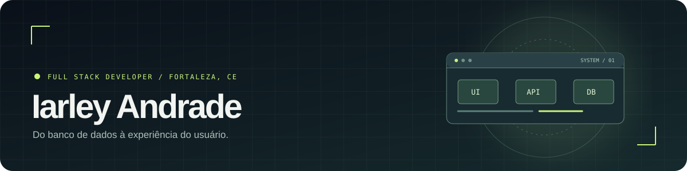
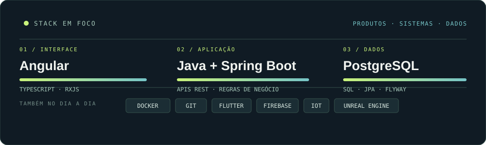

  

 

### Olá, sou o Iarley 👋

Desenvolvedor **Full Stack** e estudante de Ciência da Computação. Trabalho principalmente com **Angular, Java, Spring Boot e PostgreSQL**, construindo funcionalidades completas em sistemas reais: da modelagem e das regras de negócio até APIs e interfaces usadas no dia a dia.

Gosto de entender o problema, conversar sobre a solução e cuidar da experiência de quem vai usar o produto.

  <a href="https://iarleyandrade.github.io/"><strong>Conheça meu portfólio ↗</strong></a>
  &nbsp;·&nbsp;
  <a href="https://www.linkedin.com/in/andrade-iarley/">LinkedIn</a>
  &nbsp;·&nbsp;
  <a href="mailto:antiarley2002@gmail.com">E-mail</a>

---

### No que eu trabalho

| Interface | Aplicação | Dados e entrega |
| :--- | :--- | :--- |
| Angular · TypeScript · RxJS | Java · Spring Boot · APIs REST | PostgreSQL · Docker · Git |

Também desenvolvo aplicações com **Flutter** e exploro integração entre software, dispositivos IoT e jogos quando o projeto pede.

### Projetos em foco

- **Plataforma institucional em produção** — funcionalidades de análise e visualização de dados, com atuação entre interface, backend e banco de dados. O código e os detalhes internos não são públicos.
- **EDUCP Certificados** — aplicativo Flutter para gerar certificados em PDF, organizar layouts e histórico e sincronizar arquivos de forma opcional.
- **TocTocApp** — campainha inteligente que conecta ESP8266, Firebase e aplicativo Flutter.
- **Twilight Dawn** — arquitetura e mecânicas de um sistema de combate por turnos em Unreal Engine.

### Stack em foco

  

Tecnologias escolhidas para construir produtos completos: interfaces, APIs, regras de negócio, dados e entrega.

---

Fortaleza, CE · Aberto a conversar sobre produtos, sistemas e oportunidades

